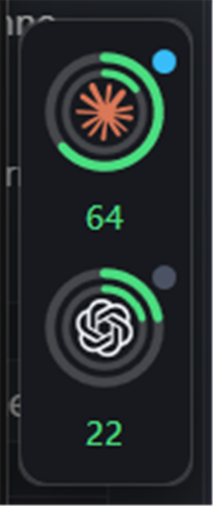
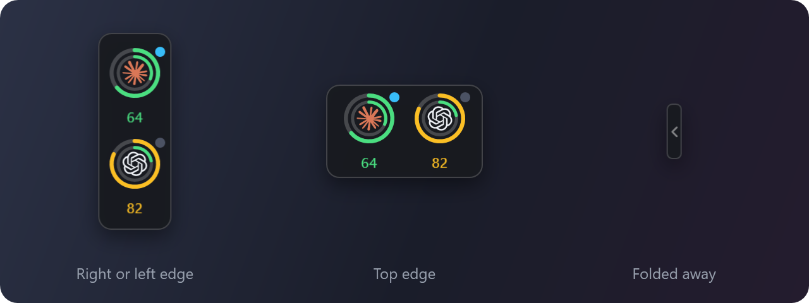

<div align="center">

# UsageDock

**Your Claude and Codex quotas, always in sight, never in the way.**

A tiny native Windows 11 dock that sits on the edge of your screen and shows how much of your
Claude Code and Codex limits you have left.

[](https://github.com/444chak/usagedock/releases/latest)


[](LICENSE.md)



</div>

---

## Highlights

|   |   |
| --- | --- |
| 🎯 **Glanceable** | Two rings per provider: the 5 hour window outside, the weekly window inside. Green, amber at 70%, red at 90%. |
| 🪶 **Featherweight** | Native C# / WPF. No WebView, no Electron, no browser engine. About 55 MB of memory. |
| 🖱️ **Never in the way** | Always on top, but never steals focus, never shows in the taskbar or Alt+Tab, and cannot block a click outside what it draws. |
| ↔️ **Goes where you want** | Right, left or top edge. Drag it along the edge, or onto another monitor. Fold it into a small tab when you need the space. |
| 🔒 **Private** | Reads local files. No token is ever logged, cached or sent anywhere. |
| ⚡ **Live activity** | A dot shows when Claude Code is working, waiting for you, or idle. |

## Install

1. Download **`UsageDock-<version>-win-x64.msi`** from the [latest release](https://github.com/444chak/usagedock/releases/latest).
2. Run it. No admin rights needed. It ends on a confirmation page with **Launch UsageDock** ticked.
3. Right click the tray icon and pick **Start with Windows**, and **Install Claude Code hooks** if
   you want the activity dot. Restart Claude Code afterwards.

> [!NOTE]
> The builds are not code signed, so SmartScreen says "Windows protected your PC" the first time.
> Click **More info**, then **Run anyway**.

Upgrading is the same: run the new MSI over the old one. It closes the running dock, replaces it
in place, and starts it again.

<details>
<summary><b>Other downloads</b></summary>

<br>

| File | Size | Needs |
| --- | --- | --- |
| `UsageDock-<version>-win-x64.msi` | ~55 MB | nothing. **Recommended.** |
| `UsageDock-<version>-win-x64.exe` | ~140 MB | nothing, portable |
| `UsageDock-<version>-win-x64-framework-dependent.exe` | ~0.3 MB | [.NET 10 Desktop Runtime](https://dotnet.microsoft.com/download/dotnet/10.0) |

All three are the same app. The MSI installs to `%LOCALAPPDATA%\Programs\UsageDock`, adds a Start
Menu entry, and can be removed from **Settings > Apps**.

If you use a portable executable, put it somewhere permanent before installing the hooks, not in
Downloads. The hooks store the path to the executable, so deleting it leaves Claude Code calling
something that is not there. If you do move it, start the new copy once and it repairs its own
hook entries.

</details>

## Using it

**Hover a provider** to open its detail card: plan, activity, every quota window with a progress
bar and a reset countdown, and how old the reading is.

<p align="center">
  
</p>

**Hover the dock** to reveal a thin strip at its start:

- drag the **grip** to slide the dock along its edge, or across to another monitor;
- click the **arrow** to fold the dock into a small tab against the edge. Click the tab to bring it back.

**Right click the tray icon** for everything else:

| Item | What it does |
| --- | --- |
| Refresh usage now | Polls both providers immediately. Double clicking the icon does the same. |
| Dock position | Right, left or top edge. |
| Fold away | Folds or unfolds the dock. |
| Reset position | Back to the middle of the primary monitor, unfolded. |
| Start with Windows | Launches the dock at sign in. |
| Install / Uninstall Claude Code hooks | Turns the activity dot on or off for Claude. |
| Live Claude usage from Claude Code | Feeds the dock the quotas Claude Code reports to its status line. |
| Open data folder | Config, cache and logs. |

### Reading the rings

| | |
| --- | --- |
| Outer ring | Rolling 5 hour window. Its percentage is the number under the ring. |
| Inner ring | Weekly window. |
| Colour | Green below 70%, amber from 70%, red from 90%, per ring. |
| Dot | 🔵 working · 🟡 waiting for you · ⚪ idle |

When a window's reset time passes, the dock drops it to 0% straight away, without waiting for
Claude or Codex to report again, and the card shows `reset`.

## Where the numbers come from

Both providers are read from files already on your machine. Nothing is sent anywhere.

| Provider | Source | Freshness |
| --- | --- | --- |
| **Codex** | Rate limits the Codex CLI and VS Code extension record in `%USERPROFILE%\.codex\sessions\` | As fresh as your last Codex turn |
| **Claude** | Usage history Claude Desktop writes to disk | Every 15 minutes while Claude Desktop is open |
| **Claude** (opt in) | What Claude Code reports to its status line, in a terminal | Every Claude Code response |
| **Claude** (if available) | Usage endpoint, with the token of the standalone Claude Code CLI | Live |

Quotas are per account, so usage from the web, the browser extensions or another machine is
included the next time one of these sources refreshes.

<details>
<summary><b>Claude in detail</b></summary>

<br>

**The usage endpoint.** The standalone Claude Code CLI stores an OAuth token in
`%USERPROFILE%\.claude\.credentials.json`. When one is there it is read, strictly read only, and
used as a bearer token for one request. It is preferred because it is live and carries exact
reset times. The file is never modified, and the token is never logged, cached or written
anywhere. 401 and 403 are reported as a credentials problem rather than retried; 429 honours
`Retry-After`; anything else backs off exponentially from 30 seconds to 30 minutes.

**The local usage history.** Claude Desktop keeps its session in an encrypted store, so on those
machines there is no token to use, and decrypting another application's protected store is not
something this app does. It does not need to: Claude Desktop writes `plan-usage-history.json`, one
sample every fifteen minutes. The classic installer keeps it in `%APPDATA%\Claude\`, the Store
package in `%LOCALAPPDATA%\Packages\Claude_*\LocalCache\Roaming\Claude\`. Both are checked and the
newest wins.

```json
{ "t": 1788899116963, "org": "...", "u": { "fh": 52, "sd": 14 } }
```

`fh` is the five hour window, `sd` the seven day window. The `org` identifier is never read.

The history has no reset timestamp. Usage only grows inside a window and drops when one rolls, so
the start of the current run of non zero samples locates the window, and the reset is one window
length later, accurate to about half a sampling interval. When that cannot be determined the card
says `unknown` rather than guessing.

The file is watched, so a new sample shows up the moment it lands rather than at the next poll.
Fifteen minutes remains the ceiling: no amount of polling can beat the rate at which Claude Desktop
samples.

**The status line feed.** Claude Code passes its status line the five hour and weekly percentages
with their exact reset times, taken from every API response. **Live Claude usage from Claude
Code** in the tray menu installs `UsageDock.exe --usagedock-statusline` as that status line, which
keeps the `rate_limits` object and nothing else of the payload, in
`%USERPROFILE%\.usagedock\claude-statusline.json`. Of this and the desktop history, whichever
reading is newer wins, and the desktop history borrows the exact reset times while they still
apply.

Claude Code allows one status line. If you already have one, UsageDock chains in front of it and
passes the payload on byte for byte, so your line looks exactly as before; unticking the menu item
puts your original command back verbatim. Without one, UsageDock draws a short line of its own,
such as `5h 21% · weekly 3%`.

This only flows while Claude Code runs in a terminal: the Code tab of Claude Desktop does not run
status lines. Usage from claude.ai or the desktop app shows up at your next Claude Code response,
or at the next desktop sample, whichever comes first.

</details>

<details>
<summary><b>Codex in detail</b></summary>

<br>

Every Codex session writes a rollout file, `rollout-*.jsonl`, and each turn records the rate limits
the server reported, for both the 5 hour and the weekly window, with exact reset times. UsageDock
reads the tail of the most recent rollouts and keeps the record with the newest timestamp.

It deliberately does not trust file dates for this. Codex keeps a session's file open while the
session lives, and Windows leaves its modification time at creation until the file closes, so a
long VS Code session would otherwise look older than a short one started after it.

`%USERPROFILE%\.codex\auth.json` is opened read only and checked only for whether a session
exists. No token is read out of it.

</details>

## Activity

Claude Code reports what it is doing through hooks, which you install from the tray menu:

| Hook event | Dot |
| --- | --- |
| `UserPromptSubmit`, `PreToolUse`, `PostToolUse` | 🔵 working |
| `Notification` | 🟡 waiting for you |
| `SessionStart`, `Stop`, `SessionEnd` | ⚪ idle |

Each hook runs `UsageDock.exe --usagedock-hook <state>`, which writes a tiny file and exits before
any UI loads, in 5 to 15 ms. It can never fail the Claude Code turn it is attached to. A hook can
be missed when a terminal is killed, so a stale working or waiting state fades back to idle after
five minutes.

Installing the hooks only adds or removes entries marked `--usagedock-hook`. Hooks from other
tools are left alone, and `settings.json` is backed up to `settings.json.usagedock-bak` before the
first change.

Codex has no hooks, so its dot follows how recently a session was written to.

## Your data

Everything UsageDock keeps lives in `%APPDATA%\UsageDock\`, and none of it holds a secret:

| File | Contents |
| --- | --- |
| `config.json` | edge, position along it, folded or not, monitor, edge margin, poll interval |
| `cache.json` | last good reading per provider, so the dock is never blank at start up |
| `logs\` | one log per day, seven days kept |

The files Claude Code writes through UsageDock are the exception: the activity files at
`%USERPROFILE%\.usagedock\activity\` and the status line feed at
`%USERPROFILE%\.usagedock\claude-statusline.json`. Claude Code from the Microsoft Store runs
inside an MSIX container that redirects AppData, so writing there would land in a private copy
the dock never sees. The profile root is shared.

To pin the dock to a display, set `monitorDeviceName` in `config.json`, for example
`\\.\DISPLAY2`. If that display is gone, the dock falls back to the primary one.

**To uninstall**: tray menu, **Uninstall Claude Code hooks**, untick **Live Claude usage from
Claude Code**, quit, then remove UsageDock from
**Settings > Apps** and delete `%APPDATA%\UsageDock\`.

## Build from source

Needs the [.NET 10 SDK](https://dotnet.microsoft.com/download/dotnet/10.0).

```bash
dotnet build -c Release
dotnet test
```

The executable lands in `src\UsageDock\bin\Release\net10.0-windows\win-x64\`. Quit the dock before
building: MSBuild cannot overwrite a running `UsageDock.exe`, and says so with a confusing MSB3027
about `apphost.exe`.

To build the MSI:

```bash
dotnet tool install --global wix --version 6.0.2
wix extension add -g WixToolset.Util.wixext/6.0.2
wix extension add -g WixToolset.UI.wixext/6.0.2
pwsh installer/build.ps1 -Version 0.2.2
```

WiX 6 is pinned because version 7 requires accepting a maintenance fee licence.

<details>
<summary><b>Under the hood</b></summary>

<br>

**Why it cannot block a click.** The whole window design is built around this.

- The dock window is exactly the size of what it draws. There is no oversized transparent layer.
- The hover strip is added to the window only while the cursor is over the dock, and removed as
  soon as it leaves. The folded tab is its own exact size.
- `AllowsTransparency` is off. Windows 11 rounds the corners through DWM, and the few unpainted
  corner pixels answer `HTTRANSPARENT` to `WM_NCHITTEST`, so clicks there reach what is underneath.
- The hover card is a separate window carrying `WS_EX_TRANSPARENT`, so every click falls through it.
- `WS_EX_NOACTIVATE`, and `MA_NOACTIVATE` in answer to `WM_MOUSEACTIVATE`, mean clicking or
  dragging the dock never takes focus from what you are typing in.
- `WS_EX_TOOLWINDOW` keeps it out of the taskbar and Alt+Tab.

Verified at 125% scale on every edge, folded and unfolded: one window of exactly the drawn size,
transparent corners, focus unchanged by clicks and drags.

**Multi-monitor and DPI.** The app is `PerMonitorV2` aware. Everything is computed per monitor in
physical pixels and applied with `SetWindowPos`, so a display at a different scale gets an exact
placement. Display, DPI and work area changes all trigger a reposition.

**Project layout**

```
src/UsageDock/
  App.xaml.cs          entry point, single instance, wiring
  MainWindow.xaml.cs   the dock: hit testing, hover strip, drag, fold
  Models/              quota windows, snapshots, config, dock edge
  Providers/           Claude and Codex readers and parsers
  Services/            config, cache, logging, backoff, hooks, polling, file watching
  Native/              Win32 interop, monitors, hit testing
  Tray/                notification area icon and menu
  Ui/                  rings, cells, hover card, dock geometry
installer/             WiX MSI
tests/UsageDock.Tests/
```

Working on the code? Read [`AGENTS.md`](AGENTS.md) first: it lists the invariants and the traps
that already cost time.

</details>

## License

[PolyForm Noncommercial 1.0.0](LICENSE.md). You are free to use, study, modify and share UsageDock
for any noncommercial purpose, personal or within a nonprofit, school or public body. Selling it,
bundling it into a paid product, or any other commercial use needs prior written permission:
[open an issue](https://github.com/444chak/usagedock/issues) to ask.

---

<sub>UsageDock is an independent project, not affiliated with or endorsed by Anthropic or OpenAI.
Claude and Codex are trademarks of their respective owners.</sub>
